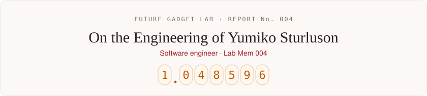

  

Software engineer at the Future Gadget Lab (Lab Mem 004), writing mostly Go and TypeScript. ゆみこせかいでいちばんかわいい！

  
  
  
  
  

| Specimen | Language |
| --- | --- |
| [nexus](https://github.com/YumikoKawaii/nexus) | Go |
| [hermeneus](https://github.com/YumikoKawaii/hermeneus) | Go |
| [keue](https://github.com/YumikoKawaii/keue) | Go |
| [hlidskjalf](https://github.com/YumikoKawaii/hlidskjalf) | Go |
| [akashic](https://github.com/YumikoKawaii/akashic) | TypeScript |

<i>El Psy Kongroo.</i>

